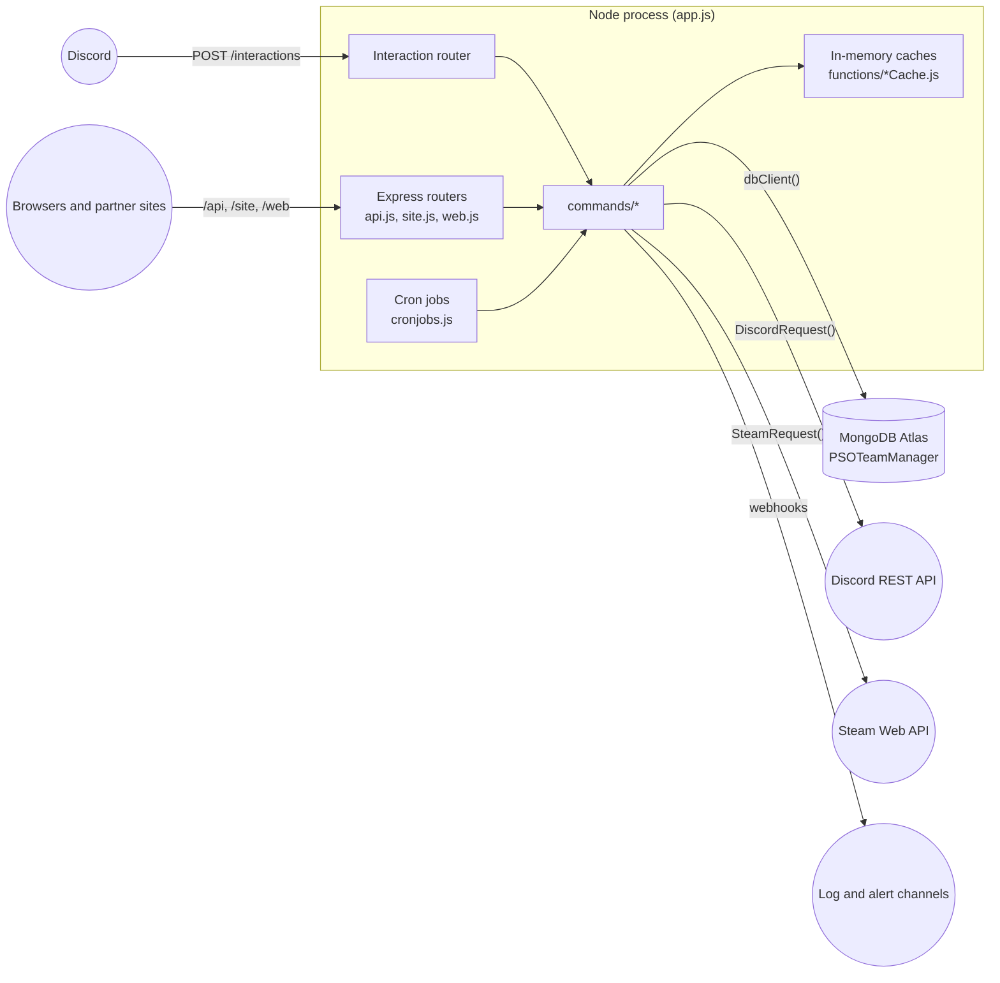

# Architecture

PSO Team Manager is one Node.js process (ES modules, Express) that is both a Discord bot and a small web backend. It has no gateway (WebSocket) connection to Discord. It works through **HTTP interactions** (Discord POSTs to `/interactions`) and the **Discord REST API**. All state is in one MongoDB database, and some of it is cached in memory.



## Startup

1. [`index.js`](../index.js) (production) imports [`commands.js`](../commands.js), which registers all slash commands, then imports `app.js`. `npm start` runs `app.js` directly and skips registration.
2. `app.js` picks **online** or **local** mode from whether the TLS files in `CERTKEY` and `CERT` exist (see [setup.md](setup.md#local-mode-and-online-mode)).
3. It mounts `/site`, `/api`, `/web` and `/interactions` on one Express app and starts the HTTP server. In online mode it also starts the HTTPS server.
4. Once listening, it pings Mongo and sets `global.isConnected = true`. `/api` returns 500 until then. It then loads the current season, active teams, national selections, leagues and nationalities, and fills the caches.
5. In online mode only, it posts any leftover crash log to `CRASHESHOOK` and starts the [cron jobs](scheduled-jobs.md).

A crash (`uncaughtException`) writes the error to `ERROR_LOG` and exits with code 1. The process manager or container is expected to restart the app.

## Handling Discord interactions

Every request to `/interactions` is checked against `PUBLIC_KEY` (`VerifyDiscordRequest` in [`utils.js`](../utils.js)). The router then branches on the interaction type:

| Type | How it's routed |
|---|---|
| `PING` | Returns `PONG`. |
| Autocomplete | By command name or by the focused option's name: `nationality`, `selection`, `league`, `league-all`, `league-inactive`, and so on. Most fall back to nationality autocomplete. |
| Button / select menu | Exact `custom_id`s in `componentRegister` (`confirm_transfer`, `cancel_deal`, …), then `custom_id` prefixes (`approve_deal_<id>`, `match_result_<id>`, `lineup_…`, …). Only in the PSAF server, apart from `vote_` buttons on the World Cup server. |
| Modal submit | `custom_id` prefixes: `match_result`, `match_stats_`, `move_the_match_`. |
| Slash command | See the lookup order below. |

Slash commands are looked up in this order:

1. `help`, `now` and `timestamp` (any server).
2. If the request comes from `WC_GUILD_ID`: commands flagged `wc`.
3. If the request comes from `GUILD_ID`: the hand-written `if (name === …)` chain in `app.js` (older commands), then commands flagged `psaf`.
4. Commands flagged `app` (global, so any server or DM).

If nothing matches, or a handler throws, the user gets an ephemeral "Failed to process the … command" reply.

### Responding

Handlers don't answer through the Express `res` object, except for `PING` and autocomplete. They call Discord's REST endpoints through the helpers in [`functions/helpers.js`](../functions/helpers.js):

- `quickResponse` / `silentResponse`: reply right away (`silentResponse` is ephemeral).
- `waitingMsg`, then `updateResponse`: defer the reply ("thinking…"), then edit it. Use this for anything that takes longer than about 3 seconds, which is Discord's limit.
- `followUpResponse` / `publicFollowUpResponse`: send further messages.
- `postMessage`, `updatePost`, `deleteMessage`, `sendDM`: channel and DM messages outside the interaction.

### Two ways commands are defined

| | Older way | Newer way (use this) |
|---|---|---|
| Definition | `xxxCmd` object exported from a command module | Object with `name`, `description`, `options`, `func` and the scope flags `psaf`, `wc`, `app` |
| Registration | Listed by hand in `GUILD_COMMANDS` / `ALL_COMMANDS` in `commands.js` | The module's default export is added to [`commandsRegister.js`](../commandsRegister.js) |
| Dispatch | `if (name === …)` in `app.js` | Automatic, through the `psaf`, `wc` and `app` maps |

`app.js` also has an `if (commandsRegister[name])` check. It never matches, because `commandsRegister` is a function, not a map.

Commands with subcommands use `handleSubCommands(options, {sub: handler})`. Use `optionsToObject(options)` to turn Discord's option array into a plain object.

## Permissions

There's no separate permission system. Handlers check the caller's Discord roles with helpers from `functions/helpers.js`:

- `isTopAdminRole`: president and engineer.
- `isAdminRole` / `isMemberAdmin`: top admins plus admins.
- `isStaffRole` / `isMemberStaff`: admins plus staff.
- `isManagerRole` / `isManager`: club managers and PG managers.

Role and channel IDs are hard-coded in [`config/psafServerConfig.js`](../config/psafServerConfig.js) (`serverRoles`, `serverChannels`), so moving to another server means editing that file. A few commands also check specific Discord user IDs.

## Web surfaces

- **`/api`** ([`api.js`](../api.js)): a JSON API. In online mode it requires `x-api-key` set to `PSAF_API_KEY` or `BRYLOS_API_KEY`, or a same-origin browser request. The route handlers reuse the functions from `commands/`.
- **`/site`** ([`site.js`](../site.js)): EJS pages styled with Tailwind (matches, teams, a single match).
- **`/web`** ([`web.js`](../web.js)): serves the prebuilt React app from `web/`. Login uses Discord OAuth2 ([`functions/siteUtils.js`](../functions/siteUtils.js), with the redirect URI hard-coded to the production domain). Sessions are stored in Mongo (`siteSessions`). `/web/api/*` forwards to `/api` with the API key, for logged-in admins only.

## Data access

[`functions/mongoClient.js`](../functions/mongoClient.js) wraps a single `MongoClient`:

```js
const result = await dbClient(async ({ teams, players, contracts }) => {
  return teams.findOne({ id })
})
```

`dbClient(callback)` connects, passes the callback an object with every collection, and returns the callback's result. It keeps a count of callbacks in progress and **closes the connection when that count reaches zero**, so code must never keep a collection object after its callback returns. See [data-model.md](data-model.md) for the collections.

## Caches

| Cache | File | Contents | Refreshed |
|---|---|---|---|
| Discord members | `functions/playersCache.js` | All members of a server, fetched in pages of 1,000 (up to 10,000) | 60-second TTL |
| Leagues, nationalities | `functions/allCache.js` | `LeagueConfig` (not archived, sorted by `order`) and `Nationalities` | At startup, and by `refreshAllLeagues` / `refreshAllNationalities` after edits |
| Countries, selections | `functions/countriesCache.js` | `Nationalities` and `NationalTeams` | 500-second TTL |
| Squads | `functions/squadsCache.js` | `Squads` | TTL, same pattern as countries |
| Current season | `commands/season.js` | The open `Seasons` document. Read with `getFastCurrentSeason()` | At startup, daily at 08:00, and on season changes |

While a cache is being filled it holds an empty array, and other callers poll every 5 seconds until it has data. `getCache` in `allCache.js` waits forever if the value stays empty, for example if Mongo was unreachable at startup. `getActiveLeagues()` calls `.filter` on a promise and would throw, but nothing calls it at the moment.

## Outbound calls

- **Discord:** `DiscordRequest(endpoint, options)` in [`utils.js`](../utils.js) calls `https://discord.com/api/v10/` with the bot token. On HTTP 429 it waits `retry_after` and retries. Other errors are posted to `ERRORHOOK` and thrown. `DiscordUploadRequest` sends multipart uploads.
- **Steam:** `SteamRequest(type, params)` calls the Steam Web API with `STEAM_API_KEY` and appends each URL to `STEAM_LOG` for the daily usage report.
- **Webhooks:** `logSystemError` (`ERRORHOOK`), `sendErrorLog` (`CRASHESHOOK`), and the transfer and season log (`WEBHOOK`) used by contracts, transfers, disbanding teams and seasons.

## Repository layout

```
app.js              Express app, interaction router, startup and crash handling
index.js            production entry: commands.js, then app.js
commands.js         slash-command registration script
commandsRegister.js modules that use the newer command definition
cronjobs.js         scheduled jobs
api.js, site.js, web.js   web routers
commands/           feature modules; each exports handlers and command definitions
  confirmations/    deals, loans and approval buttons
  league/           league config, groups, tables
  lineup/           match lineups
  matches/          scheduling, results, referees, moves, notifications
  nationalTeams/    selections and voting
  player/           Steam ID, rating, pictures, unique ID, player API
  search/           search indexes and the search command
  squads/           squad management (not registered yet)
  teams/, transfers/
functions/          Mongo wrapper, caches, shared helpers, Steam and site utilities
config/             server IDs, countries, generated league data, Mongo client
site/               EJS templates and Tailwind CSS
web/                prebuilt React bundle
```
